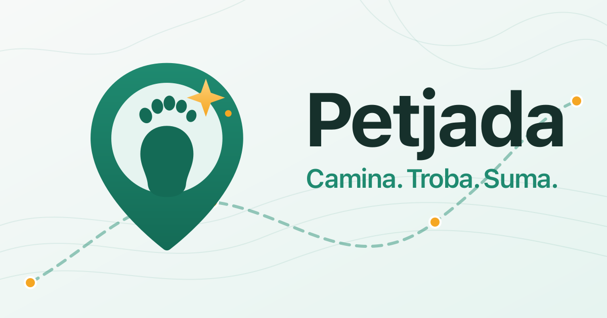

# Petjada

**Camina. Troba. Suma.**

PWA de rutes a peu amb realitat augmentada geogràfica. L'usuari crea o tria una ruta, la camina i veu objectes (billboards) ancorats a punts reals del recorregut. Quan s'hi apropa, els captura i suma punts. Tota la validació de captures i punts es fa al servidor.



## Estructura

```
apps/web         PWA (Vite + React + TypeScript, Chakra UI, react-icons, Mapbox GL JS v3)
apps/api         API (NestJS + PostgreSQL/PostGIS, SQL directe amb pg)
packages/shared  Tipus i constants compartits (contracte HTTP)
scripts/         Generació d'icones, cover, splash i imatges dels objectes
```

## Requisits

- Node 22+ i pnpm 9 (`corepack enable`)
- Docker (per a PostGIS i, opcionalment, l'API)
- Un token públic de Mapbox (`pk.*`) amb accés a l'API Directions

## Arrencada en local

```bash
cp .env.example .env         # posa-hi el teu VITE_MAPBOX_TOKEN
pnpm install
docker compose up -d db      # PostGIS
pnpm --filter api migrate    # migracions
pnpm --filter api seed       # usuaris de prova: test@petjada.app (admin) i editor@petjada.app (editor)
pnpm dev:api                 # API a http://localhost:3000/api
pnpm dev:web                 # PWA a https://localhost:5173 (certificat autosignat)
```

## Login

No hi ha contrasenyes. En obrir l'app es crea un usuari **convidat** i es pot jugar de seguida. Per no perdre el progrés, des de la pestanya "Compte" s'introdueix un email i s'hi envia un **enllaç màgic** d'un sol ús (15 minuts) que inclou també un **codi de 6 xifres** per entrar-lo dins de l'app instal·lada (a iOS l'enllaç s'obre a Safari, no a la PWA). En verificar, el progrés del convidat es fusiona amb el compte sense duplicar captures.

En desenvolupament, si no hi ha `SMTP_HOST` a `.env`, l'API **escriu l'enllaç i el codi al seu log** en lloc d'enviar el correu. Així es pot entrar amb qualsevol email, també amb els usuaris de prova del seed.

L'access token dura 15 minuts i viu només en memòria; el refresh token rotatiu va en una cookie `httpOnly`.

Alternativa amb tot dins de Docker (BD + API, amb migracions i seed automàtics):

```bash
docker compose up -d
pnpm dev:web
```

Altres ordres:

```bash
pnpm test                    # tests (vitest) de web i api
pnpm lint && pnpm typecheck
pnpm icons                   # regenera icones, cover, splash i objectes des dels SVG
```

## Provar-ho al mòbil

La càmera, la brúixola i els sensors només funcionen amb **HTTPS**. El servidor de Vite ja serveix HTTPS amb un certificat autosignat.

1. Posa el mòbil a la mateixa xarxa Wi-Fi que l'ordinador.
2. Arrenca `pnpm dev:web`; Vite mostra l'adreça de xarxa (p. ex. `https://192.168.1.20:5173`).
3. Obre-la al mòbil i accepta l'avís del certificat.
   - **Android (Chrome):** "Avançat" → "Continua".
   - **iOS (Safari):** "Mostra els detalls" → "Visita el lloc web". Si la càmera no s'activa, revisa Configuració → Safari → Càmera.
4. Afegeix-la a la pantalla d'inici per tenir-la com a app (mode `standalone`).
5. A iOS, el permís de brúixola i sensors es demana amb el botó dins del mode càmera (cal un gest de l'usuari).

La PWA parla amb l'API a través del proxy `/api` de Vite, així que el mòbil només necessita accedir al port de Vite.

## Provar-ho des de l'escriptori (mode simulació)

Si el navegador no deixa acceptar el certificat autosignat, es pot servir per HTTP només per a l'escriptori (sense càmera ni sensors):

```bash
DEV_HTTP=1 pnpm dev:web      # http://localhost:5173
```

Amb `VITE_ENABLE_SIM=true` apareix el botó "SIM" a baix a l'esquerra. En obrir el panell, "GPS real" activa la simulació:

- **Segueix la ruta:** reprodueix el recorregut de la ruta activa a velocitat de caminar (×1, ×4, ×10), incloent-hi la tornada.
- **Clic al mapa:** la posició es desplaça caminant fins al punt tocat.
- **Heading i pitch:** controls lliscants per provar el mode càmera sense sensors.

Tot el que depèn del GPS (filtre, petjades, visibilitat, captura, track, finalització) funciona igual amb la font simulada.

## Desplegament amb Docker

`docker compose up -d --build` aixeca tres contenidors: `petjada-db` (PostGIS), `petjada-api` (port **7275**, fa migracions i seed en arrencar) i `petjada-web` (port **7274**, fitxers estàtics de la PWA). Les variables `VITE_*` s'incrusten al build de la PWA, així que cal definir-les (com a mínim `VITE_MAPBOX_TOKEN`) abans de construir la imatge.

Al proxy invers (Nginx Proxy Manager) cal un sol host amb HTTPS, perquè la cookie de sessió necessita el mateix origen:

| Camp | Valor |
|---|---|
| Domini | `petjada.<el-teu-domini>` → `http://<ip-servidor>:7274` |
| Custom Location `/api` | `http://<ip-servidor>:7275` |
| SSL | Let's Encrypt, Force SSL |

Variables mínimes al stack: `VITE_MAPBOX_TOKEN`, `JWT_SECRET`, `APP_URL=https://petjada.<el-teu-domini>` i, per rebre els correus de login, `SMTP_HOST`, `SMTP_PORT`, `SMTP_USER`, `SMTP_PASS`, `SMTP_FROM`. Els ports es poden canviar amb `WEB_PORT` i `API_PORT`.

## Com funciona

- **Rutes:** creació automàtica (1, 3 o 5 km, anada i tornada opcional) amb Mapbox Directions `walking`, o manual tocant punts al mapa. Els objectes es col·loquen sobre la línia amb `ST_LineInterpolatePoint` cada `OBJECT_SPACING_M` metres, repartits entre anada i tornada; més lluny, més punts.
- **GPS:** `watchPosition` d'alta precisió, filtre per `accuracy` i salts impossibles, mitjana ponderada 1/accuracy². Wake Lock durant la ruta i menys freqüència quan l'usuari és quiet.
- **Objectes:** billboards WebP amb flotació i ombra el·líptica, visibles dins del rang configurat. Els de tornada només apareixen quan s'ha arribat al punt de gir.
- **Captura:** el servidor comprova `ST_DWithin` amb el radi configurat, la precisió, la ruta activa i la velocitat des de l'última captura. Un objecte capturat no torna a sortir mai a aquell usuari.
- **Fitxes i àlbum:** cada objecte pot tenir una fitxa (títol, text, imatge) lligada al lloc que s'obre en capturar-lo i queda a l'àlbum "Les meves troballes". Sense contingut propi, es mostra una fitxa genèrica.
- **Col·leccions per zona:** agrupen objectes de diverses rutes dins d'un polígon. Les peces no trobades es veuen com a silueta i mai se'n revela el contingut. Completar-la dona bonus i una insígnia.
- **Rols:** `player`, `editor` (ajuntaments, museus: col·leccions, rutes oficials i fitxes) i `admin`. Els permisos es comproven sempre a l'API.
- **Finalització:** ruta completada quan el track cobreix ~90% del recorregut (buffer de 20 m) i bonus proporcional a la longitud.
- **Mode càmera:** vídeo de la càmera posterior amb el mapa de Mapbox transparent a sobre, sincronitzat amb el GPS filtrat, la brúixola i l'orientació del mòbil. Màquina d'estats MOVING → ALIGNING → LOCKED amb histèresi. Sense WebXR.

Tots els llindars (radi de captura, rang de visibilitat, FOV, graus d'alineació, velocitat màxima...) es configuren a `.env`; vegeu `.env.example`.
